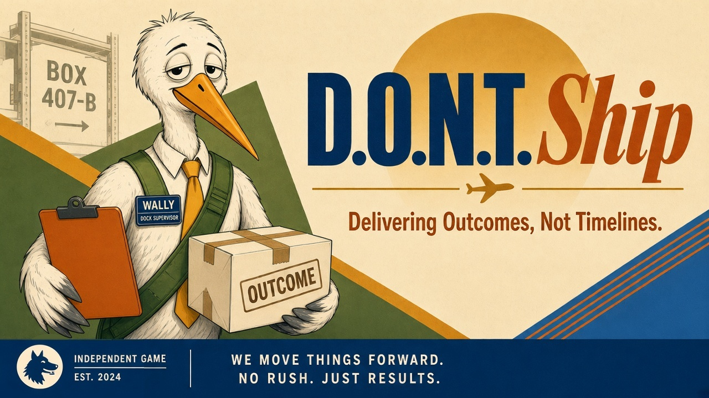

# D.O.N.T. Ship

**Delivering Outcomes, Not Timelines.**

You're a multiverse courier at Box 407-B. Wally the stork hands you a parcel and three doors, each with odds posted by the J.E.V.: pick one, run its pocket universe, and deliver to the customer without getting hit. Your bankroll tracks what you win; your O.D.D.S. score tracks how well calibrated your bets are.

## Play online

**[ds.dataknife.ai](https://ds.dataknife.ai)**

## Run locally

From the repo root (needs an HTTP server; opening `index.html` via `file://` won't work):

```bash
python -m http.server 8080
```

Then open [http://localhost:8080](http://localhost:8080).

## Controls

- **Door hall:** click a door, or press **1 / 2 / 3**.
- **Run:** **WASD / arrows** to move, **Space** to jump, mouse wheel to zoom.
- **Touch (phones / tablets, landscape):** tap a door; in a run, drag anywhere on the left half for the joystick and tap the right half to jump. The masthead has a fullscreen button.
- **Install:** use the browser's Install button (Android / desktop Chrome) or Share → Add to Home Screen (iOS). It plays offline after the first visit.
- **Sound:** **M** mutes (or use the speaker button in the masthead).
- No WebGL? Add `?renderer=2d` for the legacy 2D version.

## Docs

- [Gameplay](docs/GAMEPLAY.md): loop, odds and payout, goals, worlds, hazards
- [Development](docs/DEVELOPMENT.md): layout, debug hooks, headless checks, deploy, config
- [Plan](docs/PLAN.md): iso direction, roadmap, hazard tag reference
- [Progression](docs/PROGRESSION.md): careers, quotas, tools, calibration trust
- [Narrative](docs/NARRATIVE.md): story, theme, factions, endings
- [Brand assets](assets/brand/README.md): Fen, Wally, palette, art files

## License

[Apache License 2.0](LICENSE); see [NOTICE](NOTICE). Three.js in `vendor/` is MIT-licensed ([vendor/three.LICENSE](vendor/three.LICENSE)).
